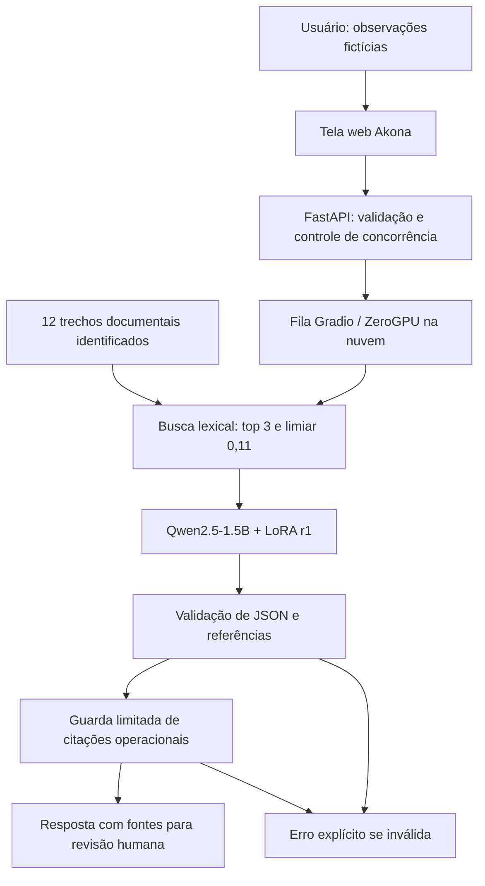

# Ficha técnica — Akona Energy · CitizenTech Iluminação IA

Componente de IA generativa da Global Solution CitizenTech: **triagem de relatos de iluminação pública com LLM treinada localmente, recuperação de documentos e revisão humana**. O fine-tuning de Qwen2.5-1.5B-Instruct foi concluído em 17/11/2026. A demonstração executa inferência real com o adaptador r1 selecionado sobre exemplos fictícios.

**[Abrir a demonstração em nuvem](https://laia020-citizentech-iluminacao-ia.hf.space/demo)** · [Space e arquivos](https://huggingface.co/spaces/laia020/citizentech-iluminacao-ia) · [API pública](https://laia020-citizentech-iluminacao-ia.hf.space/docs). Interface, API e inferência desta versão executam no Hugging Face, com o Mac do autor desligado. O plano gratuito tem filas e cotas, sem garantia de disponibilidade contínua.

| Campo | Descrição |
|---|---|
| Produto / componente | Akona Energy / CitizenTech Iluminação IA |
| Cidadão e território | Cidadãos que relatam problemas de iluminação e equipes de triagem. Osasco/SP é o território demonstrativo do MVP de DevOps fornecido pela equipe; não há operação municipal comprovada. |
| Problema | Relatos incompletos e leituras isoladas podem levar a conclusões sem evidência sobre falhas de iluminação pública. |
| Proposta de valor | Organizar evidências, citar documentos pertinentes, explicitar informações ausentes e recusar conclusões sem suporte antes da decisão humana. |
| Arquitetura | Interface web → FastAPI → fila Gradio/ZeroGPU na nuvem → busca lexical → Qwen2.5-1.5B + LoRA → validação de esquema/referências → guarda limitada → revisão humana. |
| Fontes de dados | Cenários e procedimentos autorais fictícios; duas sínteses institucionais atribuídas, SP Regula e CPFL. [Inventário, direitos e trechos](experimentos/v5-1.5b/base/fontes.csv). |
| Modelos de IA | Qwen/Qwen2.5-1.5B-Instruct e LoRA r1 treinado localmente. Experimento histórico MLX com inferência FP16; serviço em nuvem PyTorch FP32, sem fusão ou novo treinamento. Busca lexical, sem modelo de visão nem sensor conectado neste componente. |
| MVP de DevOps informado | [Akona Energy](https://ca-akona-energy-prod.salmoncoast-770d275b.eastus2.azurecontainerapps.io/). Referência visual externa; a conexão com esta API de IA ainda não foi demonstrada. |
| POC de IA | [Demonstração pública em nuvem](https://laia020-citizentech-iluminacao-ia.hf.space/demo). Não depende de serviço ou túnel no Mac. Cotas/filas da hospedagem gratuita podem impedir temporariamente a inferência. |
| Repositório / vídeo | [Repositório público no GitHub](https://github.com/laia020/citizentech-iluminacao-ia). Será utilizado o vídeo do grupo, com demonstração da IA; **link ainda não informado**. |
| Indicadores | Medidos em teste sintético: acerto, alucinação, recall, conformidade de esquema e latência. Impacto proposto, ainda não medido em campo: tempo de triagem, completude dos relatos e taxa de encaminhamentos revisados por pessoa. |
| ODS relacionados | ODS 7 — Energia limpa e acessível; ODS 11 — Cidades e comunidades sustentáveis. Alinhamento proposto, sem comprovação de impacto de campo. |

## Equipe

Integrantes informados pelo grupo para esta entrega:

| Integrante | RM |
|---|---|
| Lucas Laia Manentti | 97709 |
| Guilherme Faustino Vargas | 98278 |
| Ryan Perez Pacheco | 98782 |
| João Lucas Yudi Redi Handa | 98458 |
| Guilherme Dal Posolo Matheus | 98694 |

## Navegação e entrega

- [Página de RPA: evidências e roteiro de apresentação](docs/PAGINA-RPA.md). A nova rota `/rpa` está preparada no código; sua disponibilidade pública depende da publicação do pacote atualizado no Space.
- [Começar a demonstração](COMECAR_AQUI.md) e [roteiro para o professor](POC_PARA_PROFESSOR.md).
- [Relatório técnico atual](experimentos/v5-1.5b/docs/RELATORIO-1_5B.md) e [notebook executado](experimentos/v5-1.5b/notebooks/06_treinamento_e_avaliacao_1_5b.ipynb).
- [Placar A/B/C](experimentos/v5-1.5b/avaliacao/placar.json), [respostas brutas](experimentos/v5-1.5b/avaliacao/evidencias/) e [cinco erros com propostas](experimentos/v5-1.5b/avaliacao/cinco_erros.json).
- [Contrato de integração](docs/INTEGRACAO.md), [proteção adicional de citações](experimentos/v6c-validacao/README.md) e [adaptador treinado](artefatos/README.md).

O ciclo atual é **`experimentos/v5-1.5b`**. Resultados de 7B nas pastas anteriores são históricos; suas métricas não pertencem ao modelo atual. Artefatos de 500M foram excluídos por solicitação do usuário. As candidatas v6/v6b de mudança da geração foram rejeitadas e não estão ativas. A guarda v6c envolve a API original sem trocar pesos, dados, busca ou prompt.

## Escopo e funcionamento

O sistema recebe uma pergunta com relato, observações visuais descritas em texto ou leituras declaradas. Recupera até três trechos e produz análise estruturada com fontes, limitações e recusa quando apropriado. O código da API recoloca o identificador da ocorrência; IDs de teste, categorias e gabaritos não são enviados à LLM.



Esta POC demonstra **triagem e recusa fundamentada**, sem diagnosticar peças elétricas, certificar calibração, transformar ADC em lux sem base ou executar reparos. Todos os alvos de treino têm hipóteses causais vazias. Não abre chamados no MVP externo, controla robôs ou consome automaticamente componentes dos colegas.

## Demonstração pública e integração

Abra [a tela hospedada](https://laia020-citizentech-iluminacao-ia.hf.space/demo), escolha um exemplo fictício e clique para analisar. A inferência ocorre no servidor de nuvem. Nenhum processo precisa permanecer ativo no Mac do autor. Em cota esgotada, fila ou falha, o serviço informa indisponibilidade; não usa respostas gravadas nem transfere a geração ao Mac.

Consumidor do grupo: enviar o mesmo JSON documentado abaixo para `POST https://laia020-citizentech-iluminacao-ia.hf.space/v1/analisar`. A integração deve ocorrer pelo servidor do Akona; a tela do cidadão chama seu próprio backend. O contrato de campos e respostas foi preservado. O endpoint Gradio `/analisar` também está disponível e retorna `status_code` e `body`.

Publicação verificada em 18/11/2026: `/demo`, `/docs` e `/ready` acessíveis; dois casos conhecidos da POC responderam HTTP200, com triagem pertinente e recusa por dado ausente. Uma primeira tentativa FP16 gerou saída inválida e foi preservada; a versão ativa usa FP32, também validada no ensaio CPU. Não são casos inéditos, novo benchmark ou prova de ausência de alucinação. [Validação da nuvem](experimentos/v7-nuvem/docs/VALIDACAO-NUVEM.json), [ciclo e limitações](experimentos/v7-nuvem/README.md), [implantação reproduzível](deploy/hf-space/README.md).

O componente oferece demonstração web e API pública para análise de ocorrências fictícias. Os resultados A/B/C abaixo pertencem ao experimento MLX original, não são automaticamente métricas do backend em nuvem.

## Reprodução local opcional, sem novo treinamento

Na pasta existente do projeto:

```zsh
cd ~/Projects/citizentech-iluminacao-ia
.venv/bin/python scripts/preparar_runtime.py check
.venv/bin/python scripts/servir_poc_validada.py
```

Abra a [tela interativa](http://127.0.0.1:8000/demo) e aguarde a disponibilidade. Há cinco exemplos fictícios e campos para pergunta e observações próprias. Confira as fontes: o modelo pode errar. O serviço não instala pacotes, baixa pesos ou inicia treinamento ao atender perguntas. Não utiliza respostas gravadas como reserva.

| Endereço local | Finalidade |
|---|---|
| `/demo` | Interface de demonstração |
| `/docs` | Documentação interativa da API |
| `/openapi.json` | Contrato gerado pela aplicação em execução |
| `/health` | Estado do processo; não substitui prontidão do modelo |
| `/ready` | Disponibilidade para inferência |
| `POST /v1/analisar` | Análise ou recusa estruturada |

Encerre com **Control+C no terminal que iniciou o serviço**. Este é um procedimento opcional de reprodução/desenvolvimento; a versão pública atende na nuvem. O serviço local anterior foi encerrado por solicitação do usuário. Não inicie duas cópias na mesma porta; para outra porta livre, use `--port 8001` e ajuste o endereço no navegador/cliente.

`scripts/servir_poc_validada.py` inclui a proteção atual. `scripts/servir_1_5b.py` e `citizentech serve` preservam o serviço original **sem essa guarda**, para reprodução do experimento.

## Preparar uma nova cópia em outro Mac

### Requisitos e ambiente

Esta seção reproduz o experimento MLX original; a nuvem usa o backend PyTorch separado. O backend MLX requer **macOS em Apple Silicon** e Python **3.12**, conforme `pyproject.toml`. Foi verificado em M1 Max com 64 GB de memória unificada, Python 3.12.16, MLX 0.32.4 e MLX-LM 0.32.2. Esse hardware de referência não é um mínimo universal: a inferência mediu pico MLX de 3,780 GB e o treino de 12,234 GB, além da memória do macOS e demais processos. Não planejar swap como memória de treinamento.

É necessário ter `uv` disponível. Reserve disco para base original, conversão FP16 e ambiente: só as duas cópias dos pesos somam aproximadamente 6,2 GB, além de bibliotecas, caches e margem para operações. Windows, Linux e containers Azure não executam este backend MLX automaticamente; a portabilidade para esses ambientes não foi validada.

Obtenha uma cópia completa do repositório, incluindo `uv.lock`, fontes, dados, evidências e `artefatos/`:

```zsh
git clone https://github.com/laia020/citizentech-iluminacao-ia.git
cd citizentech-iluminacao-ia
```

**Somente numa cópia nova, sem `.venv` existente**, prepare o ambiente:

```zsh
uv venv --python 3.12 --prompt "venv-citizentech-iluminacao-ia"
source .venv/bin/activate
uv sync --locked --extra train --group dev
uv pip check --python .venv/bin/python
```

Isso instala dependências locais fixadas pelo lockfile; não atualizar versões para reproduzir o resultado. Se já houver ambiente, inspecione suas dependências antes de sincronizar: não recrie nem substitua a `.venv` por rotina.

### Base oficial e adaptador já treinado

A base completa fica fora do Git por tamanho. O pacote [qwen1.5b-lora-r1.zip](artefatos/qwen1.5b-lora-r1.zip), aproximadamente **4,6 MB**, acompanha o repositório e contém o adaptador escolhido e sua configuração, permitindo usar a versão treinada sem repetir o fine-tuning. Para baixar o arquivo isolado pelo GitHub, use a opção de download do arquivo; o manifesto também acompanha o código.

| Artefato fixado | Valor |
|---|---|
| Modelo oficial | `Qwen/Qwen2.5-1.5B-Instruct` |
| Revisão Hugging Face | `989aa7980e4cf806f80c7fef2b1adb7bc71aa306` |
| Conversão | FP16 MLX, sem quantização |
| Adaptador escolhido | r1, rank 16, 1.245.184 parâmetros treináveis |
| SHA-256 do adaptador | `c905fee58cb4c0c44baeb9ac14dd9e9b7e412f280b3024c825441d018d573dce` |
| Integridade e procedência | [runtime-manifest.json](artefatos/runtime-manifest.json) |

Estes comandos são **operações intencionais de preparação numa nova cópia**. O primeiro usa rede para obter a revisão oficial e memória/disco para convertê-la; não treina. O segundo verifica o pacote e restaura o adaptador selecionado, recusando sobrescrever pesos diferentes:

```zsh
.venv/bin/python scripts/preparar_runtime.py base --download --convert
.venv/bin/python scripts/preparar_runtime.py import-adapter
.venv/bin/python scripts/preparar_runtime.py check
```

A ferramenta prepara `models/qwen-1.5b-original/`, `models/qwen-1.5b-fp16/`, o vínculo relativo `experimentos/v5-1.5b/models → ../../models` e `experimentos/v5-1.5b/adapters/selected/final/`. Preserva vínculos corretos existentes e recusa destinos de procedência divergente. Não apague destinos conflitantes: confira sua origem. Se a preparação for interrompida, inspecione os arquivos preservados antes de retomar.

`check` é somente leitura: não carrega a LLM, treina, baixa ou converte. Confira `archive_verified`, `base_sha_matches_original`, `model_link_correct` e `adapter_present_and_verified`. Um campo `false` exige investigação; imprimir o relatório não garante prontidão. O SHA canônico da base está no manifesto. Uma conversão diferente não é equivalente bit a bit sem análise da procedência.

Depois, inicie a POC conforme a seção de execução. A restauração do pacote real foi testada em pasta temporária isolada, inclusive repetição idêntica e vínculo relativo. A base existente foi conferida por SHA. Após a publicação, um clone público sem credenciais foi baixado: o adaptador foi restaurado a partir do ZIP publicado e os 47 testes passaram no código clonado, usando o ambiente Python já existente. **Instalação completa em outro Mac ainda não foi executada**; não houve novo download da base, conversão ou inferência nessa conferência. [Registro da publicação](experimentos/v5-1.5b/docs/validacao-publicacao.json).

## Usar e integrar a API

Com o serviço iniciado, em outro terminal na raiz:

```zsh
.venv/bin/python examples/cliente.py --arquivo examples/ocorrencia.json
```

O [exemplo de entrada](examples/ocorrencia.json) é fictício e pode ser enviado também pelo `/docs`:

```json
{
  "ocorrencia_id": "SIM-001",
  "pergunta": "Que análise preliminar é possível?",
  "simulada": true,
  "relato": "Luminária observada apagada durante a noite. A causa não foi inspecionada.",
  "sensores": [],
  "observacoes_visuais": []
}
```

Forneça alguma observação em relato, sensores ou observações visuais. Datas exigem fuso explícito; calibração declarada exige referência, sem certificar sua validade. A API limita tamanho da entrada e contexto. Consulte campos e enumerações em `/docs` e no [guia de integração](docs/INTEGRACAO.md).

| HTTP | Tratamento esperado pelo consumidor |
|---|---|
| 200 | Exibir análise ou recusa, fontes, limites e `request_id`; conferir conteúdo. |
| 413 / 422 | Corrigir corpo acima de 32 KiB ou entrada/contexto inválido. |
| 429 | Serviço ocupado; respeitar `Retry-After`. |
| 502 | Geração inválida ou `fonte_incompativel`; apresentar falha explícita e encaminhar para revisão. |
| 503 | Modelo/backend indisponível; não inventar resposta substituta. |

O cliente de referência tem timeout e não cria ordens de serviço. O inicializador local escuta apenas `127.0.0.1`; a implantação pública separada atende no Hugging Face e exige marcação de dados fictícios. Este guia não orienta expor o Mac ou usar túnel.

### Proteção adicional de citações

A guarda atual rejeita incompatibilidades conhecidas: citações institucionais genéricas de CPFL/SP Regula para perguntas explícitas sobre técnico/equipe, ordem/protocolo/contrato/garantia ou preço que aqueles trechos não informam. Retorna `502` com `codigo: "fonte_incompativel"`. Não reescreve a análise, escolhe outra fonte ou repete a geração até acertar.

É uma verificação determinística limitada, sujeita a falsos bloqueios e outros erros não detectados. Não é um verificador semântico universal. Os [quatro casos reais](experimentos/v6c-validacao/docs/api-real.json) registram um bloqueio e três controles aceitos. A guarda não foi incluída no placar A/B/C; rejeição não conta como resposta correta ou redução medida de alucinação.

## Dados, fontes e avaliação

- **Treino:** 400 exemplos; **validação:** 80, com 64 usados na seleção após excluir sobreposições identificadas.
- **Teste v5:** 30 casos composicionais, cinco por categoria, escritos antes deste treino: respondível, insuficiente, contradição, não consta, fora de escopo e indução.
- **Regressão histórica:** 120 casos antigos conhecidos, separados e não apresentados como novo teste.
- **Corpus:** 12 documentos Markdown, um trecho por documento; dez procedimentos autorais e duas sínteses atribuídas. [Fontes, formato, jurisdição, direitos, SHA e contagem](experimentos/v5-1.5b/base/fontes.csv).
- **Busca:** top 3, limiar 0,11 herdado da validação; recall@1/@3 macro no teste de 77,8%/90,0%. Nos cinco casos respondíveis: 50,0%/90,0%.
- **Geração A/B/C:** greedy, temperatura 0, saída de até 512 tokens, contexto 2.048, sem reparação oculta de JSON ou tentativas até acertar. B/C recebem as mesmas mensagens e trechos; C acrescenta o adaptador.

Dados, gabaritos e revisão técnica foram produzidos por IA relacionada à autoria, sem validação humana independente. Casos fictícios demonstram comportamento controlado, não ocorrências reais. Geração, revisão, agrupamentos e limitações de independência estão no [relatório](experimentos/v5-1.5b/docs/RELATORIO-1_5B.md) e no [congelamento pré-treino](experimentos/v5-1.5b/configs/frozen_manifest.json). Não enviar dados pessoais reais nesta POC.

### Treinamento efetivamente executado

Base com 1.543.714.304 parâmetros; LoRA em q/v das últimas 16 camadas, rank 16, scale 2, dropout 0,05. Batch 1 com acumulação 4; AdamW, learning rate 0,0001, decay 0,01, corte de norma 1 e semente 42. Pesos-base preservados; cálculo do treino em FP32 e inferência FP16.

| Candidato | Microsteps / atualizações | Duração medida | Pico MLX | Loss final de validação | Resultado |
|---|---:|---:|---:|---:|---|
| r1 | 400 / 100 | 8 min 36 s | 12,234 GB | 0,1505 | Selecionado |
| r2 | 800 / 200 | 15 min 56 s | 12,234 GB | 0,1840 | Preservado |

Ambos chegaram a 63/64 em status e 100% em esquema/referências na seleção. O desempate predefinido favoreceu r1 por mediana de geração ligeiramente menor: 1,608 s contra 1,623 s; isso não comprova superioridade estável de velocidade. Escolha feita antes de abrir o teste. São dois orçamentos com a mesma semente e primeiros 400 passos iguais, não replicações independentes. Mais treino não demonstrou melhora neste ciclo. [Logs e procedências](experimentos/v5-1.5b/avaliacao/treinamento/).

### Resultado medido — experimento original, sem a guarda adicional

| Métrica, 30 casos por configuração | A: base sem contexto recuperado | B: RAG simples | C: RAG + LoRA |
|---|---:|---:|---:|
| Acerto semântico na revisão técnica por IA | 46,7–50,0% | 33,3–36,7% | 83,3–90,0% |
| Alucinação | 23,3–30,0% | 40,0–43,3% | 6,7–13,3% |
| Esquema e referências válidos | 26,7% | 6,7% | 100% |
| Status puro correto | 10,0% | 0,0% | 93,3% |
| Acerto integral | 10,0% | 0,0% | 83,3–86,7% |
| Mediana de geração | 1,315 s | 1,499 s | 1,644 s |

C teve **25 acertos semânticos, três erros e dois incertos**, com duas alucinações confirmadas e duas incertas. As faixas mantêm incertos no denominador; **não são intervalos estatísticos**. Esquema válido, referência existente e status correto não garantem conteúdo correto. B foi pior que A nesta amostra.

O ganho semântico C−A foi de 33,3–43,3 pontos percentuais, com intervalo nominal pareado de 95% de 20–60 pp. A redução observada de alucinação foi de 10–23,3 pp, mas seu intervalo de −3,3–40 pp inclui zero. Portanto, houve ganho de acerto nesta amostra e menos alucinações observadas, **sem redução conclusiva de alucinação**. Os intervalos condicionam-se ao conjunto sintético pequeno e aos rótulos por IA; não demonstram generalização de campo. C−A combina contexto e adaptação; B/C compara acrescentar o adaptador neste pipeline.

A mediana de 1,644 s e p95 de 1,798 s de C medem geração, excluindo carregamento, fila, rede e interface. Não garantem latência total. Os [cinco erros reais](experimentos/v5-1.5b/avaliacao/cinco_erros.json) contêm entrada, resposta, causa provável e proposta: quatro exemplos de C e um de B, sem alegar cinco alucinações confirmadas de C. Evidências originais preservadas.

## Reproduzir e verificar

### Conferir evidências sem treinar

Notebook executado, JSON/JSONL e tabelas podem ser lidos sem carregar a LLM ou baixar pesos. Respostas originais A/B/C e logs pequenos foram exportados para fora das pastas ignoradas pelo Git. Lê-los comprova o registro da execução, não constitui nova execução.

Com o ambiente de desenvolvimento preparado:

```zsh
.venv/bin/python -m pytest -q
.venv/bin/python -m ruff check src scripts tests examples
.venv/bin/python scripts/preparar_runtime.py check
```

As contagens de testes evoluem por etapa; o [registro da migração](experimentos/v7-nuvem/docs/validacao-software.json) distingue os ambientes MLX original e PyTorch de nuvem, incluindo exclusões específicas. Cobrem contrato, busca, congelamento, integridade de prompts, limites, guarda, adaptador, ponte e publicação. Testes de software não substituem a avaliação da LLM. A [conferência original](experimentos/v5-1.5b/docs/VALIDACAO-FINAL.json), a [restauração isolada](experimentos/v5-1.5b/docs/reproducao-adaptador-readme.json) e a [verificação anterior do README](experimentos/v5-1.5b/docs/validacao-readme.json) permanecem como registros históricos.

### Repetir inferência A/B/C, intencionalmente

Com base e adaptador preparados, estes comandos usam GPU e geram 30 respostas cada. Escolha nomes ainda inexistentes; os scripts recusam colisões:

```zsh
.venv/bin/python scripts/experimento_1_5b.py evaluate --name reproducao-A-01 --mode base_sem_contexto --split test
.venv/bin/python scripts/experimento_1_5b.py evaluate --name reproducao-B-01 --mode rag_simples --split test
.venv/bin/python scripts/experimento_1_5b.py evaluate --name reproducao-C-01 --mode rag_finetuning --adapter adapters/selected/final --split test
```

Saídas em `experimentos/v5-1.5b/runs/NOME/`. Esses comandos reproduzem o experimento sem a guarda HTTP. O teste já foi observado; repetir não é validação inédita. Novas respostas exigem revisão própria antes de atribuir acerto semântico ou alucinação; não copiar os rótulos antigos automaticamente. Logs originais em `avaliacao/evidencias/`. Outra plataforma/versão pode impedir igualdade bit a bit.

### Repetir fine-tuning, somente quando necessário

Não é necessário treinar para demonstrar ou repetir inferência do adaptador selecionado. Para um novo treino deliberado, usar cópia experimental separada com dados e versões congelados, conferir alimentação, memória/disco e fazer teste curto antes da carga longa. Não recriar `.venv`, apagar checkpoints ou substituir o adaptador selecionado.

`scripts/experimento_1_5b.py train --help` documenta `--name`, `--lr`, `--microsteps`, `--smoke` e a autorização explícita `--execute-training`. Os candidatos usam r1=400 e r2=800 microsteps, sob os critérios condicionais do [protocolo](experimentos/v5-1.5b/configs/protocol.json). O seletor original refere-se a r1/r2 e recusa seleção após teste aberto. Não contornar essa proteção nem escolher pesos pelo teste observado. Novos pesos ou mudanças de dados, prompt e busca exigem ciclo separado e avaliação própria; não herdam o placar histórico.

## Organização dos arquivos

```text
README.md                       ficha técnica, execução e reprodução
pyproject.toml / uv.lock         dependências e versões
src/citizentech_ia/              API, contratos, busca, geração e guarda
scripts/preparar_runtime.py     base oficial e importação verificada
scripts/servir_poc_validada.py   POC com guarda
examples/                       entrada fictícia e cliente HTTP
tests/                          testes principais de software
artefatos/                      adaptador ZIP e manifesto SHA-256
experimentos/v5-1.5b/
  base/                         fontes, documentos e trechos
  dados/                        treino e validação
  configs/                      protocolo, modelo, seleção e congelamentos
  codigo_congelado/             código original pré-treino
  avaliacao/                    teste, placar, respostas, erros e logs exportados
  revisao/                      julgamentos e justificativas
  notebooks/                    notebook executado do modelo atual
  docs/                         relatório e verificações
experimentos/v6c-validacao/      limites e regressões da guarda adicional
docs/INTEGRACAO.md               contrato e pendências do produto integrado
```

`models/`, `adapters/`, `runs/`, `.venv/` e caches são ignorados. O pacote em `artefatos/` e as exportações de `avaliacao/` devem acompanhar a publicação. Não publicar credenciais, `.env`, dados pessoais, ambientes ou pesos-base por engano.

## Checklist da disciplina de IA generativa

| Item do enunciado | Onde conferir / estado |
|---|---|
| Tarefa, gabarito e casos “não consta” | `avaliacao/test.jsonl`, `dados/`, protocolo e notebook v5. |
| Fontes e trechos identificados | `base/fontes.csv`, `base/chunks.jsonl` e documentos v5. |
| Recall@1/@3 e limiar | Relatório, notebook e configuração de busca v5. |
| JSON, referências e recusa | Contrato, saídas brutas e placar; falhas dos modelos-base preservadas. |
| Fine-tuning versus RAG | Dois candidatos LoRA reais; A/B/C com a mesma base. |
| Placar e interpretação | `avaliacao/placar.json` e relatório com incertezas/limites. |
| Cinco erros reais e propostas | `avaliacao/cinco_erros.json`. |
| README e reprodução | Este guia, lockfile, manifesto e adaptador. Instalação completa em outro Mac ainda não validada. |
| Ficha técnica e equipe | Abertura deste README; replicar ficha comum nas entregas das disciplinas. |
| Demonstração e URLs públicas | Repositório público, demonstração web e API publicados. |

Submissões separadas no Teams não eliminam a exigência de produto comum e comunicação real entre componentes do PDF. Dados simulados documentados são admitidos; não apresentá-los como sensores reais ou validação municipal. Este checklist não substitui a revisão das entregas das outras disciplinas.

## Limitações, privacidade e pendências finais

POC local implementada, treinamento e avaliação registrados. Interface com exemplos fictícios, responsividade por CSS e testes de fluxo; inspeção visual real no navegador ainda não concluída. A guarda não corrige todos os erros de conteúdo. A maior parte do corpus é autoral e não comprova regulamentação ou canais de Osasco. Revisão humana independente é recomendada e permanece pendente; não foi declarada como realizada.

Antes da entrega externa, completar:

- Conferência do repositório público, com dados, evidências, notebook e pacote do adaptador acessíveis durante a correção.
- Conferir a disponibilidade da demonstração web e da API durante a correção.
- Ficha técnica comum nas disciplinas e conferência das cotas/disponibilidade da hospedagem durante a correção.
- Definição pelos titulares da licença do código, dados e adaptador e revisão de direitos dos ativos incluídos.

O modelo-base é Apache-2.0, com cópia da licença no pacote. Isso não licencia automaticamente o código ou os materiais autorais do grupo. Páginas institucionais completas não foram redistribuídas; o catálogo informa a situação das sínteses. Os exemplos não exigem segredos. Uso com dados reais exigiria controles de acesso, retenção e privacidade além desta configuração local demonstrativa.

## Problemas comuns

| Situação | Como proceder |
|---|---|
| Porta em uso | Reutilizar o serviço existente, encerrá-lo pelo terminal de origem ou escolher outra porta. |
| Modelo/adaptador ausente | Conferir `check`; numa cópia nova, preparar base e importar pacote. Não treinar para resolver arquivo ausente. |
| SHA divergente ou procedência desconhecida | Parar e inspecionar manifesto, revisão e destino. Preservar arquivos e verificações. |
| Falha ao baixar a base | Conferir conexão e acesso à revisão pública. Não colocar tokens no README. Inspecionar a pasta antes de retomar. |
| `ModuleNotFoundError` | Conferir pasta e Python da `.venv`; numa cópia nova, concluir instalação pelo lockfile. |
| 502 de geração ou citação | Exibir erro e conferir contexto/fontes com uma pessoa; não inventar resposta substituta. |
| Pressão de memória | Interromper carga controladamente e conferir recursos. Não desativar proteções do Mac nem planejar swap. |

## Histórico e restauração documental

Esta revisão completou o README, incluiu os integrantes e preparou/verificou o pacote de reprodução. Na sequência, o usuário autorizou explicitamente publicar o repositório público `laia020/citizentech-iluminacao-ia`, incluindo os commits e o envio necessários. Sem novo treinamento, alteração do placar original ou instalação de bibliotecas.

Em 18/11/2026, a etapa posterior publicou a aplicação no Hugging Face ZeroGPU, independente do Mac. Dependências de nuvem ficaram em ambiente próprio; as 97 dependências originais foram preservadas e verificadas. O ciclo v7 registra versões, ajustes da plataforma, tentativa FP16 inválida, versão ativa FP32 e chamadas públicas. A autorização específica de implantação não é autorização permanente para gastos ou publicações futuras. Backup anterior de documentos e nota do Obsidian em `experimentos/v7-nuvem/docs/backup.json`; restaurar por comparação/cópia ao caminho original. Restaurar documentos não desfaz a implantação remota nem justifica reiniciar serviço no Mac.

O repositório foi publicado em 17/11/2026 e conferido por clone público sem credenciais e leitura HTTP do README. Pastas de modelos, adaptadores de execução, ambientes, caches e vínculos locais ficaram fora do Git; o adaptador selecionado acompanha o código no pacote verificado. A revisão de padrões comuns de credenciais não encontrou correspondências, sem constituir garantia absoluta. [Revisão anterior ao envio](experimentos/v5-1.5b/docs/revisao-pre-publicacao.json).

Backup imediatamente anterior à publicação: `/Users/lucasmanentti/.codex/backups/citizentech-publicacao-20261117-234336`, com manifesto de documentação/configuração e nota temática. Restaurar documentos por comparação e cópia do arquivo desejado ao caminho original; isso não desfaz a publicação remota. Não apagar dados ou pesos e não reescrever o histórico remoto para restaurar uma nota.

Backup anterior: `/Users/lucasmanentti/.codex/backups/citizentech-readme-20261117-232208`, com manifesto dos caminhos originais do README e da nota temática do Obsidian. Para restaurar, comparar backup e documento atual e copiar somente o arquivo desejado ao destino do manifesto, preservando mudanças posteriores. Não apagar ambientes, dados ou pesos para restaurar documentação. Regras globais do Codex preservadas.
