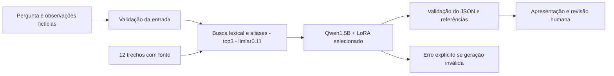

# CitizenTech — treinamento e avaliação1.5B

> Implantação posterior, 18/11/2026: [demonstração pública](https://laia020-citizentech-iluminacao-ia.hf.space/demo), executada no Hugging Face ZeroGPU com o mesmo adaptador r1 e backend PyTorch FP32, independente do Mac. [Validação da nuvem](../../v7-nuvem/docs/VALIDACAO-NUVEM.json): duas chamadas conhecidas adequadas na revisão pelo mesmo agente, com falha FP16 inicial preservada. Isso não reestima o placar MLX abaixo nem comprova generalização/integração. Os vídeos da apresentação estão relacionados na Ficha Técnica. A Ficha Técnica comum atualizada abre o README principal.

## Ficha técnica e integrantes

| Campo | Descrição |
|---|---|
| Produto / componente | Akona Energy / CitizenTech Iluminação IA |
| Cidadão e território | Cidadãos e equipes de triagem de iluminação pública; Osasco/SP no MVP demonstrativo do grupo, sem operação municipal comprovada. |
| Problema | Evitar conclusões sem evidência a partir de relatos incompletos ou leituras isoladas. |
| Proposta de valor | Organizar observações, recuperar documentos, citar fontes e explicitar recusa/informações ausentes para revisão humana. |
| Arquitetura | Tela web, API FastAPI, busca lexical, Qwen2.5-1.5B com LoRA, validação de JSON/referências e guarda limitada na API demonstrativa. |
| Fontes | Cenários fictícios e dez procedimentos autorais; duas sínteses institucionais atribuídas, detalhadas em `../base/fontes.csv`. |
| IA | Qwen/Qwen2.5-1.5B-Instruct, base FP16 e adaptador LoRA r1. |
| MVP de DevOps | [Akona Energy](https://ca-akona-energy-prod.salmoncoast-770d275b.eastus2.azurecontainerapps.io/); integração com a IA ainda não comprovada. |
| Repositório | [laia020/citizentech-iluminacao-ia](https://github.com/laia020/citizentech-iluminacao-ia) |
| Vídeo focado em IA | [Assistir à demonstração da IA no Google Drive](https://drive.google.com/file/d/1aRLiZTX9kAE6g9fWVuiMmpKt-vXvg-n2/view?usp=sharing). |
| Vídeo geral do grupo | **[INSERIR LINK DO VÍDEO GERAL AQUI]** |
| Indicadores | Acerto, alucinação, recall, esquema e latência medidos no conjunto sintético. Tempo/completude da triagem são indicadores de impacto propostos, sem medição de campo. |
| ODS | 7 e 11, como alinhamento proposto. |

| Integrante | RM |
|---|---|
| Lucas Laia Manentti | 97709 |
| Guilherme Faustino Vargas | 98278 |
| Ryan Perez Pacheco | 98782 |
| João Lucas Yudi Redi Handa | 98458 |
| Guilherme Dal Posolo Matheus | 98694 |

## Resultado local

O fine-tuning local foi concluído e o adaptador **r1** foi selecionado pelos critérios de validação fixados antes das respostas de teste. Na revisão técnica por IA dos30 casos fictícios novos, C teve25 acertos semânticos,3 erros e2 incertos; a baseA teve14 acertos,15 erros e1 incerto. Houve menos alucinações observadas emC, mas o intervalo da redução frente aA inclui zero. Não declarar redução conclusiva ou ausência de alucinação. A POC executa a LLM treinada real, com erros e limitações preservados.

Esta é a parte GenAI local do projeto; não representa entrega integrada de todas as disciplinas. A equipe está identificada acima e a publicação do repositório foi autorizada pelo usuário. A implantação posterior da API está no adendo acima; os vídeos da apresentação estão relacionados na Ficha Técnica.

## Modelo, ambiente e arquitetura

Modelo oficial `Qwen/Qwen2.5-1.5B-Instruct`, revisão `989aa7980e4cf806f80c7fef2b1adb7bc71aa306`, Apache-2.0. [Fonte primária](https://huggingface.co/Qwen/Qwen2.5-1.5B-Instruct). Base1.543.714.304 parâmetros, arquivo MLX FP16 de3.087.466.667 bytes. LoRA1.245.184 parâmetros treináveis em64 tensoresF32, rank16, q/v das últimas16 camadas, scale2, dropout0,05. A conversão e a precisão de inferência são iguais entreA/B/C; o treino calcula FP32 em memória, preservando arquivos-base.

MacBook Pro M1 Max,64GB unificada, Python3.12.16,mlx0.32.4,mlx-lm0.32.2,numpy2.5.4,transformers5.22.2. Ambiente uv/.venv e lockfile existentes preservados;97 pacotes compatíveis, sem instalar/atualizar bibliotecas nem alterar outros projetos. A memória é compartilhada com macOS; pico MLX não é consumo total do sistema.

Sistema não executa reparos, abre chamados, controla robô ou consulta sistemas externos. IDs,categorias,split e gabarito são removidos da entrada da LLM. A/B/C usam a mesma política de sistema e condições; A não recebe trechos recuperados, mas continua recebendo pergunta/observações e regras de segurança. B/C recebem mensagens e trechos idênticos; C acrescenta o adaptador. Greedy0, saída512 tokens, contexto2048, sem reparo de JSON ou repetição oculta até acertar. Saídas Markdown/YAML dos modelos-base continuam inválidas no contrato; seu conteúdo é anotado separadamente, sem corrigi-las no placar.

## Dados e fontes

400 exemplos de treino e80 de validação herdados da v3, com50/20 famílias e variantes correlacionadas. Seleção usa64 casos/16 famílias após retirar sobreposições anteriormente identificadas; os80 brutos foram gerados, revistos e preservados. O teste novo tem30 casos composicionais, um por família, cinco por categoria, escritos antes deste treinamento. O teste antigo120 permanece apenas como regressão conhecida, sem nova execução nesta rodada.

Autoria e revisão relacionadas por IA, casos sintéticos e conceitos de domínio compartilhados: não é validação externa, humana independente, cega ou de campo. Nova redação não prova independência semântica. Todos os alvos têm hipóteses causais vazias, portanto a tarefa demonstra triagem/recusa, não diagnóstico de componentes elétricos. Gabaritos são referências revisáveis, não verdade humana certificada. Os alvos ficam fora do prompt da avaliação.

Corpus:12 documentosMarkdown, um trecho por documento; dez procedimentos autorais do protótipo e duas sínteses atribuídas, SP Regula e CPFL. [Tabela com fonte,formato,licença,abrangência,número de trechos eSHA](../base/fontes.csv). Não se presumiu direito de redistribuir páginas institucionais completas. A maior parte dos critérios mede políticas autorais; esta prova não valida conhecimento institucional ou canais reais de um município. Dados e cenários fictícios não são ocorrências reais ou leituras de sensores conectados.

Busca:limiar0,11 herdado da calibração na validação80 (recall@3 macro0,95; precisão0,619). Não recalibrado após olhar o teste. No novo teste, macrorecall@1 de77,8% e recall@3 de90,0%; nos cinco casos respondíveis:50,0% e90,0%. Recall calcula a fração dos trechos-gabarito recuperados, não acerto da resposta. No caso de técnico designado, lacuna:1 não foi recuperado e houve citação CPFL sem suporte. O treino supervisionado não insere fonte-gabarito; cinco alvos de treino ficaram sem referências efetivamente recuperadas, declarado no manifesto. Comprimento máximo preparado1142/1127 tokens em treino/validação, abaixo do contexto2048.

## Treinamento e escolha

O usuário autorizou iniciar em17/11/2026, superando o estado anterior de preparação. Esse estado inicial permanece histórico no protocolo; `docs/autorizacao-e-recursos-treino.json` registra a autorização e checagens, sem mudar hiperparâmetros ou critérios congelados. AlimentaçãoAC, recursos livres e teste representativo conferidos antes da execução longa.

| Execução | Microsteps / atualizações | Duração medida | Pico MLX | Loss final de validação | Escolha |
|---|---:|---:|---:|---:|---|
| Smoke |16 /4|22,61s|12,076GB|0,8282 em4 exemplos|Somente medição/reloadOK|
| r1 |400 /100|515,99s (8min36s)|12,234GB|0,1505|Selecionado|
| r2 |800 /200|955,57s (15min56s)|12,234GB|0,1840|Preservado, não selecionado|

Batch1, acumulação4, AdamW lr0,0001, decay0,01; norma máxima1, abortar antes de atualização não finita, sementes NumPy/MLX42. Ambos alteraram os adaptadores;15 atualizações sofreram corte de norma em cada candidato, nenhuma foi pulada. Sem NaN/Inf e sem crescimento de swap. Tempos incluem validação de loss inicial/final e salvamentos, não todo o tempo de preparação/revisão. Não prometer igualdade de tempo ou bits em outra máquina/versão.

R2 foi acionado por um problema substantivo no conjunto de seleção: pergunta sobre custo de manutenção tratada como fora do escopo. Ambos atingiram63/64 em status puro e100% esquema/referências. O desempate predefinido foi a mediana de geração:1,608s emr1 e1,623s emr2. A diferença é pequena e não demonstra superioridade estável de velocidade. Na revisão técnica, r1 teve62–63/64 acertos semânticos e r2 teve62/64; esses julgamentos não substituíram a ordem de critérios. Loss menor não foi usada como critério de escolha. Nos80 brutos, ambos tiveram75/80 em status; houve falhas temporais nos casos excluídos, que continuam disponíveis.

São candidatos de orçamento, não replicações independentes: mesma base e semente, com os primeiros400 passos exatamente iguais, confirmado peloSHA dos checkpoints. A segunda rodada não demonstrou melhora só por treinar mais. Checkpoints salvam pesos; não se promete retomada idêntica de todo o estado do otimizador. Seleção criada antes de abrir respostas do teste30. Adaptador selecionado/avaliado/servido: `c905fee58cb4c0c44baeb9ac14dd9e9b7e412f280b3024c825441d018d573dce`.

## Placar real

| Configuração /30 casos | Esquema/ref. | Status puro | Acerto semântico | Acerto integral | Alucinação | Mediana de geração |
|---|---:|---:|---:|---:|---:|---:|
| A:base sem contexto recuperado | 26.7% | 10.0% | 46.7–50.0% | 10.0% | 23.3–30.0% | 1.315s |
| B:RAG simples | 6.7% | 0.0% | 33.3–36.7% | 0.0% | 40.0–43.3% | 1.499s |
| C:RAG+LoRA | 100.0% | 93.3% | 83.3–90.0% | 83.3–86.7% | 6.7–13.3% | 1.644s |

Acerto semântico julga pertinência, fatos e enquadramento do pedido independentemente do formato. Acerto integral exige também esquema/referências,fundamentação,recusa adequada e ausência de alucinação. As faixas de taxas são limites de rótulos incertos mantidos no denominador, não intervalos estatísticos. Não equiparar28/30 em status a28 respostas corretas.

Todas as90 saídas foram anotadas explicitamente em90 grupos. Pacotes ocultaram o nome do modo, mas o contexto e o estilo podem revelá-lo. Na validaçãoR2,27 grupos idênticos reutilizaram julgamentos já lidos daR1 somente após verificar caso,entrada,saída bruta e contexto exatamente iguais; os grupos alterados foram lidos separadamente. Essa reutilização foi registrada, não inferida por palavras-chave e não apresentada como nova revisão independente.

C−A:ganho semântico observado33,3–43,3 pontos percentuais, intervalo nominal conservador95% por bootstrap pareado20,0–60,0pp. Redução observada de alucinação10,0–23,3pp, mas intervalo−3,3–40,0pp inclui zero. Portanto há evidência condicional de ganho de acerto nesta amostra e redução pontual de alucinação, sem prova conclusiva desta última. Intervalos usam5000 reamostragens por família estratificadas por categoria,semente42; condicionam-se aos rótulos por IA e ao pequeno conjunto sintético, sem medir erro do revisor, generalização de campo ou correção de múltiplas comparações. B sozinho foi pior queA neste conjunto; RAG não garante melhora. C−A acrescenta contexto e especialização, portanto não isola efeito do LoRA; B/C compara a presença do adaptador neste pipeline com as mesmas entradas/trechos.

| Categoria /5 casos | Acerto semânticoC | AlucinaçãoC |
|---|---:|---:|
| contradicao | 80.0–100.0% | 0.0–20.0% |
| fora_escopo | 100.0% | 0.0% |
| inducao | 100.0% | 0.0% |
| insuficiente | 80.0% | 20.0% |
| nao_consta | 80.0–100.0% | 0.0–20.0% |
| respondivel | 60.0% | 20.0% |

C teve mediana de geração1,644s,p951,798s,pico MLX de inferência3,780GB. Essa duração exclui carregamento,fila,rede e interface; não é garantia de tempo total da API nem de outra máquina.

## Cinco erros reais e demonstração

[Entradas,contextos,saídas brutas,julgamentos,causas prováveis e propostas](../avaliacao/cinco_erros.json). Foram escolhidos após a revisão para explicar falhas, não como amostra neutra ou teste adicional. Quatro exemplos sãoC,um éB; umC tem erro de fundamentação definido, mas conteúdo/alucinação incertos. Não são cinco alucinações confirmadas deC.

| Configuração / ID de revisão | Erro observado | Causa próxima provável e proposta para ciclo futuro |
|---|---|---|
| C /6abfda30f82b | Dois pontos distintos viram mesmo ponto em conflito | Generalização do padrão de conflito; contrastar mesmos/diferentes pontos em dados novos |
| C /f9e9e829e589 | Recusa diagnosticar peça em vez de registrar dano aparente | Resposta orientada ao tema, sem seguir pergunta; contrastar registro vs diagnóstico |
| C /2016429c728e | Nega determinação de ADC já informado | Confunde pergunta de conversão com ordem; preservar valor/unidade em pares contrastivos |
| C /8da9cd0303da | Cita CPFL sem suporte para técnico designado; frase de ausência de observação ambígua | Falha de recuperação e escolha de citação; revisar aliases na validação e aceitar fontes vazias quando não pertinentes |
| B /d6e7d7528f2e | Sugere relé/rede sem evidência da foto | Usa exemplos de causas como hipóteses; especialização já mostra recusa adequada nesse mesmo caso emC |

Essas são explicações de superfície/hipóteses de causa, não mecanismos internos comprovados. Nenhum novo treinamento ou mudança de dados,limiar,prompt ou critérios foi feito após os resultados de teste. As propostas não foram apresentadas como correções já implementadas das falhas remanescentes. Uma nova correção exige ciclo separado e avaliação inédita.

## POC e entrega

Seis chamadas com o modelo selecionado real tiveramHTTP200, incluindo os cinco exemplos da tela e uma pergunta livre. Isso não significa seis acertos integrais: na leitura técnica, quatro respostas foram plenamente adequadas, uma resposta composta sobre ADC/defeito ficou incompleta/ambígua, e a pergunta de técnico respondeu a falta de documento mas citou CPFL indevidamente. [Transporte e saídas reais](teste-poc-real.json),[revisão do conteúdo](revisao-poc-conteudo.json). A POC mantém erros explícitos sem resposta gravada de reserva. Tela→API→busca→LLM é um fluxo real local; sensor,município e componentes dos colegas continuam simulados/ausentes.

Notebook executado:`../notebooks/06_treinamento_e_avaliacao_1_5b.ipynb`. [Placar e revisão](../avaliacao/placar.json),[evidências brutas portáveis](../avaliacao/evidencias/),[seleção](../configs/selected.json),[protocolo](../configs/protocol.json). A conferência final verifica dados,prompt,código preditivo,pesos,IDs fora dos90 prompts,mesmas mensagensB/C,adapterSHA selecionado/avaliado/servido,notebook e exportações. Só o texto da página foi atualizado para estado treinado, preservando sua versão congelada original; não alterou as gerações ou os exemplos usados no teste.

O PDF aceita dados simulados documentados e não fixa mínimo de parâmetros ou número de rodadas; mantém comparação, fontes, recusa, cinco erros, reprodução, produto comum/integrado e publicação. A avaliação pelo professor não é garantida por estes resultados. Equipe/RMs e território demonstrativo estão na Ficha Técnica; os vídeos estão relacionados na Ficha Técnica. Revisão humana independente é recomendação de validação, não item explícito de rotulagem integral do benchmark. A publicação autorizada do repositório não substitui disponibilidade do MVP na correção, integração real ou hospedagem da API. Não houve deploy, exposição do Mac ou alteração permanente do sistema. A verificação visual da interface no navegador continua pendente.

## Conclusão técnica e links de entrega

O adaptador r1 melhorou o acerto na amostra sintética frente à base sem contexto e ao RAG simples. Houve menos alucinações observadas, com intervalo que inclui ausência de redução; não se conclui redução estatística de alucinação. JSON e referências válidos não bastam para garantir fundamentação. A guarda adicional limita uma incompatibilidade conhecida sem alterar esse placar original. Generalização e integração de campo permanecem não demonstradas.

- Repositório: [https://github.com/laia020/citizentech-iluminacao-ia](https://github.com/laia020/citizentech-iluminacao-ia).
- Demonstração hospedada: [abrir a IA](https://laia020-citizentech-iluminacao-ia.hf.space/demo), independente do Mac.
- Vídeo focado em IA: [assistir à demonstração no Google Drive](https://drive.google.com/file/d/1aRLiZTX9kAE6g9fWVuiMmpKt-vXvg-n2/view?usp=sharing).
- Vídeo geral do grupo: **[INSERIR LINK DO VÍDEO GERAL AQUI]**.
- Reprodução: [README principal](../../../README.md), com base oficial fixada e pacote do adaptador já treinado.

Os artefatos500M foram excluídos por solicitação do usuário; os históricos7B permanecem separados e não foram usados como métricas do1.5B. Regras globais preservadas. [README do ciclo e restauração](../README.md).
